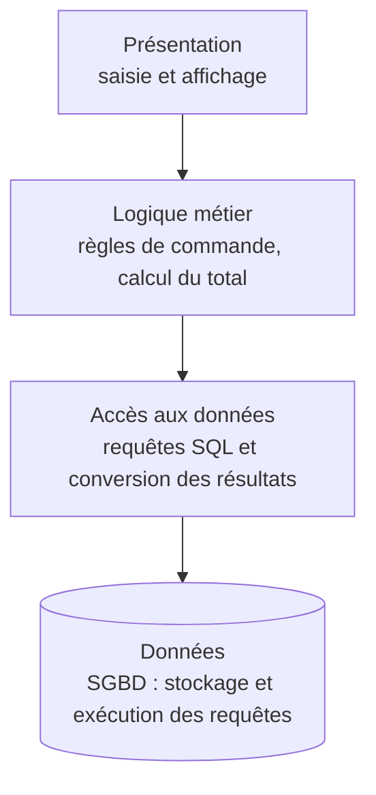
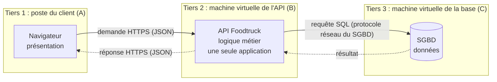

# Exercice 2 : types d'architecture et architecture N-tiers

Module I321, Programmer des systèmes distribués. Énoncé : [I321-Exercices, exercice 2](https://github.com/CPNV-KMI-I321/I321-Exercices/blob/main/exercices/exercice-2.md).

Binôme : aucun. Travail rédigé avec l'aide de l'IA, à ma demande : voir « Aide de l'IA » dans le README du dépôt.

Quatre questions à ne pas mélanger (slides du cours, page 2) :

| Question | Notion |
| --- | --- |
| Comment livrer l'application ? | monolithe / microservices |
| Qui demande et qui fournit le service ? | client-serveur / pair-à-pair |
| Quelles responsabilités ? | couches logiques |
| Où s'exécutent ces responsabilités ? | tiers de déploiement |

## 1. Reconnaître les architectures

### 1.1. Monolithe ou microservices ?

| N° | Situation | Monolithe ou microservices ? | Justification |
| --- | --- | --- | --- |
| 1 | Le catalogue, les commandes et les paiements sont des modules d'une seule application. Ils sont livrés ensemble dans un même programme serveur. | **Monolithe** | « des modules d'une seule application », « livrés ensemble dans un même programme » : un seul bloc qui se déploie d'un coup. |
| 2 | Le catalogue, les commandes et les paiements sont des services autonomes. Chaque service est déployable séparément, communique par une API et gère ses propres données. | **Microservices** | « services autonomes », « déployable séparément », « gère ses propres données » : chaque service vit et se livre seul. |
| 3 | Pour accueillir davantage de clients, on lance quatre copies identiques du programme de la situation 1 derrière un répartiteur de charge. Chaque copie contient tous les modules. | **Monolithe** (répliqué) | « copies identiques », « chaque copie contient tous les modules » : on multiplie le même bloc, on ne le découpe pas. |

### 1.2. Client-serveur ou pair-à-pair ?

| N° | Situation | Modèle des échanges | Rôles des participants |
| --- | --- | --- | --- |
| 4 | Les tablettes des clients demandent la carte au serveur du Foodtruck. Elles ne fournissent aucune donnée aux autres tablettes. | **Client-serveur** | Les tablettes sont les clients : elles demandent. Le serveur du Foodtruck fournit la carte. |
| 5 | Des ordinateurs s'échangent directement des morceaux d'un fichier. Chacun peut télécharger des morceaux et transmettre ceux qu'il possède déjà. | **Pair-à-pair** | Chaque ordinateur est un pair : il demande des morceaux **et** en fournit aux autres. |
| 6 | Un serveur central fournit une liste d'ordinateurs possédant un fichier. Les ordinateurs utilisent ensuite cette liste pour échanger directement les morceaux entre eux. | **Les deux** : client-serveur pour la liste, pair-à-pair pour les morceaux | Pour la liste : les ordinateurs demandent, le serveur central fournit. Pour le fichier : chaque ordinateur demande et fournit des morceaux ; le serveur ne transporte aucun morceau. |

## 2. Concevoir une architecture à trois tiers

### 2.1. Répartir les responsabilités

#### a. Associer les couches à leur emplacement

| Couche | Emplacement |
| --- | --- |
| Présentation | **A** (navigateur du client) |
| Logique métier | **B** (machine virtuelle de l'API) |
| Données | **C** (machine virtuelle du système de gestion de base de données) |

#### b. Associer les responsabilités aux couches

| N° | Responsabilité | Couche |
| --- | --- | --- |
| 1 | Afficher la carte des pizzas et le formulaire de commande. | présentation |
| 2 | Afficher le message de confirmation reçu après une commande. | présentation |
| 3 | Vérifier qu'un prix de pizza n'est pas négatif selon les règles métier. | logique métier |
| 4 | Calculer le total d'une commande à partir des prix de référence. | logique métier |
| 5 | Vérifier que l'utilisateur a le droit de modifier la carte. | logique métier |
| 6 | Stocker durablement les pizzas et les commandes. | données |
| 7 | Exécuter une requête SQL pour retrouver une commande. | données |

#### c. Ajouter une couche au système

**Réponse :**

1. Nom : **couche d'accès aux données** (en anglais *Data Access Layer*).
2. Ses responsabilités :
   - préparer et envoyer les requêtes SQL paramétrées (lire, créer, modifier, supprimer une pizza ou une commande) ;
   - convertir les lignes reçues de la base en objets utilisables par le métier (et les objets du métier en valeurs pour la base).

   Ce qui reste dans la couche métier : calculer le total d'une commande à partir des prix de référence (et toutes les règles de commande). Si l'on change de base de données, l'essentiel du travail porte sur la couche d'accès aux données (et sur la migration de la base elle-même) ; tant que son interface reste stable, les règles métier changent peu.
3. Schéma des quatre couches (les flèches indiquent le sens des appels ; les résultats remontent en sens inverse) :

(D'après les slides du cours, p. 10 : une couche d'accès aux données.)

### 2.2. Représenter les échanges

**Schéma et étapes :**

Liens autorisés : navigateur et API en **HTTPS**, API et base par le **protocole réseau du SGBD** (qui transporte le SQL). Il n'existe **aucun lien** entre le navigateur et la base.

Parcours d'une commande :

1. Le client clique sur « Commander » : le navigateur (tiers 1) envoie `POST /api/commandes` en HTTPS, avec les pizzas choisies et leurs quantités en JSON.
2. L'API (tiers 2) contrôle la forme de la demande (au moins une pizza, quantités entières positives). Si elle est invalide, elle répond `400 Bad Request` sans interroger la base.
3. L'API lit dans la base (tiers 3) les pizzas commandées et leurs prix de référence (`SELECT`). Si une pizza est inconnue, elle répond `400 Bad Request` ; sinon, elle calcule le total elle-même, sans jamais utiliser un prix venu du navigateur.
4. L'API enregistre la commande et son total (`INSERT`) ; le SGBD exécute la requête et confirme l'enregistrement.
5. L'API répond `201 Created` en HTTPS, avec la commande (numéro, total) en JSON.
6. Le navigateur affiche le message de confirmation.

### 2.3. Distinguer couches et tiers

| Déploiement | Nombre de tiers | Justification |
| --- | --- | --- |
| Une application locale affiche l'interface, effectue les calculs et utilise une base embarquée sur le même poste, sans autre machine. | **1** | Les trois couches s'exécutent sur le même poste ; rien n'est séparé par le réseau. |
| Une application de bureau affiche l'interface et exécute la logique métier sur le poste utilisateur. Elle accède directement à une base sur un serveur distant. | **2** | Présentation et métier sur le poste, données sur un serveur distant : deux emplacements séparés par le réseau. |
| Le navigateur assure la présentation, une machine virtuelle exécute l'API métier et une autre machine virtuelle héberge la base, comme dans le Foodtruck. | **3** | Trois emplacements séparés par le réseau : poste client, machine virtuelle de l'API, machine virtuelle de la base. |

## 3. Justifier un choix d'architecture

### 3.1. Démarrer avec une petite équipe

**Réponse :**

Un **monolithe** organisé en modules. Avantage : un seul programme à développer, tester et déployer, donc peu de travail d'exploitation, ce qui convient à deux développeurs qui ont peu de temps pour l'infrastructure, avec un trafic faible. Limite : tous les modules partagent le même cycle de livraison ; la moindre modification oblige à redéployer toute l'application, et il faudra peut-être la découper si le projet grandit.

### 3.2. Faire évoluer la plateforme

**Réponse :**

Des **microservices** : un service catalogue, un service commandes et un service paiements, un par équipe, chacun avec ses propres données et déployé séparément. Bénéfice : chaque équipe publie ses évolutions sans attendre les autres. Difficulté : les services s'appellent par le réseau, il faut donc gérer les pannes réseau, les délais et la cohérence des données entre services (par exemple une commande enregistrée dont le paiement échoue), ce que l'équipe d'exploitation devra surveiller.

### 3.3. Combiner les notions

**Réponse :**

L'API métier est **monolithique**, car tout le traitement métier tient dans une seule application déployable, et elle échange avec le navigateur en **client-serveur** : le navigateur demande, l'API répond. Le déploiement compte **trois tiers** : le poste client, la machine virtuelle de l'API et celle de la base. Ces réponses sont compatibles, car chaque notion répond à une autre question : comment l'application est livrée, qui demande et qui fournit, où s'exécutent les couches (slides, p. 2).

## 4. Vrai ou faux : vérifier une architecture

| N° | Proposition | Vrai ou faux ? | Correction si faux |
| --- | --- | --- | --- |
| 1 | Une application qui possède trois couches logiques est forcément déployée sur trois tiers. | **Faux** | Trois couches peuvent occuper un, deux ou trois tiers (voir 2.3) : une couche est logique, un tiers est un emplacement de déploiement. |
| 2 | Une API métier monolithique peut participer à une architecture à trois tiers. | **Vrai** | Monolithe et tiers répondent à deux questions différentes (slides, p. 2) : le monolithe occupe le tiers du milieu, entre le navigateur et la base. |
| 3 | Exécuter plusieurs copies identiques d'un monolithe transforme automatiquement l'application en microservices. | **Faux** | Elle reste un monolithe répliqué : chaque copie contient toute l'application. Les microservices découpent l'application en services autonomes. |
| 4 | Dans un échange pair-à-pair, un même participant peut demander des données et en fournir. | **Vrai** | Un pair est à la fois client et serveur : il demande des ressources et en fournit (slides, p. 6). |
| 5 | Si un serveur aide les participants à se découvrir, les transferts de fichiers entre eux ne peuvent pas être pair-à-pair. | **Faux** | Les transferts peuvent rester pair-à-pair : le serveur fournit seulement la liste des pairs (échange client-serveur) et ne transporte pas les morceaux, qui circulent directement entre les pairs (slides, p. 6, variante avec découverte centralisée). |
| 6 | Dans l'architecture du Foodtruck de la partie 2, le navigateur peut contourner l'API et modifier directement la base. | **Faux** | Le navigateur communique uniquement avec l'API, en HTTPS ; seule l'API accède à la base. |
| 7 | Les microservices suppriment les problèmes de panne réseau entre les composants. | **Faux** | Ils en ajoutent : les services communiquent par le réseau, il faut donc gérer les pannes, les délais et les reprises. |
| 8 | Une architecture N-tiers comporte obligatoirement exactement trois tiers. | **Faux** | N-tiers désigne une organisation en plusieurs tiers (deux, trois ou plus) ; trois tiers est un cas particulier (slides, p. 8). |

## Sources

- Cours I321 : [Les différentes architectures](https://github.com/CPNV-KMI-I321/I321/blob/main/theorie-et-concepts/les-differentes-architectures/README.md) et slides [Architectures, théorie pour l'exercice 2 (PDF)](https://github.com/CPNV-KMI-I321/I321/blob/main/assets/slides/exercice-2-slides.pdf)
- [AWS : monolithe et microservices](https://aws.amazon.com/compare/the-difference-between-monolithic-and-microservices-architecture/)
- [MDN : la relation client-serveur](https://developer.mozilla.org/fr/docs/Learn_web_development/Extensions/Server-side/First_steps/Client-Server_overview)
- [RFC 5694 : architectures pair-à-pair, sections 2 et 3](https://www.rfc-editor.org/rfc/rfc5694)
- [Microsoft Learn : architecture N-tiers](https://learn.microsoft.com/en-us/azure/architecture/guide/architecture-styles/n-tier)
